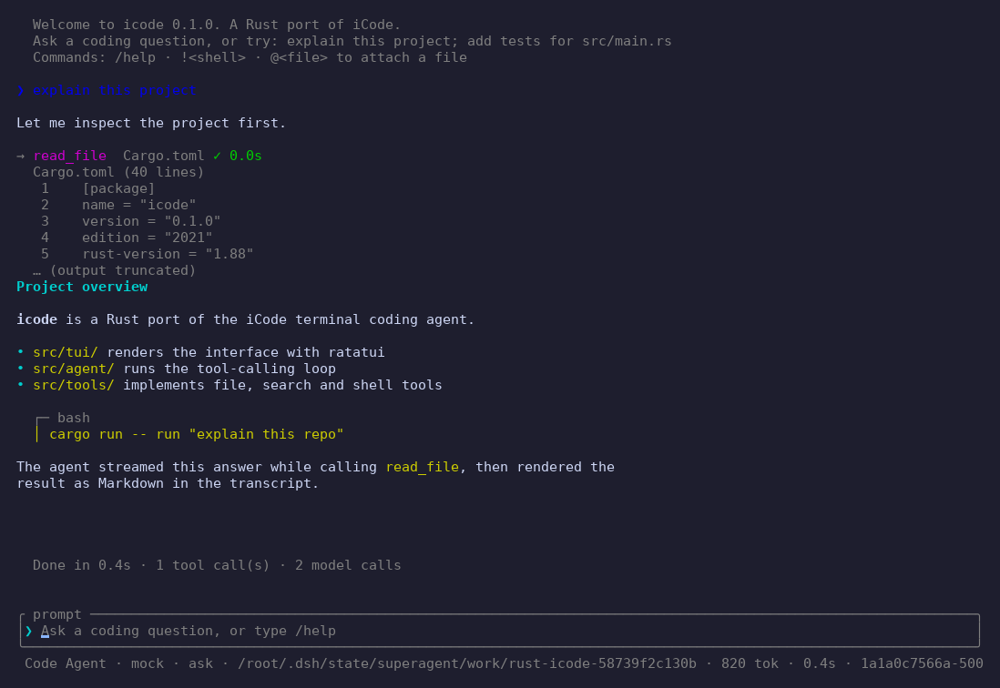
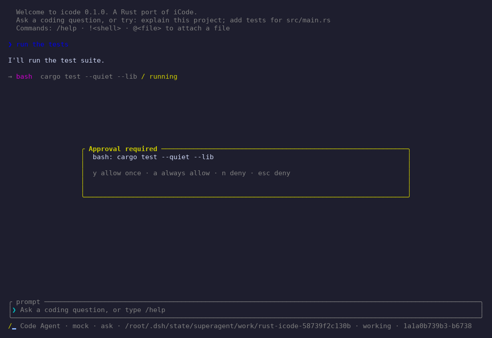
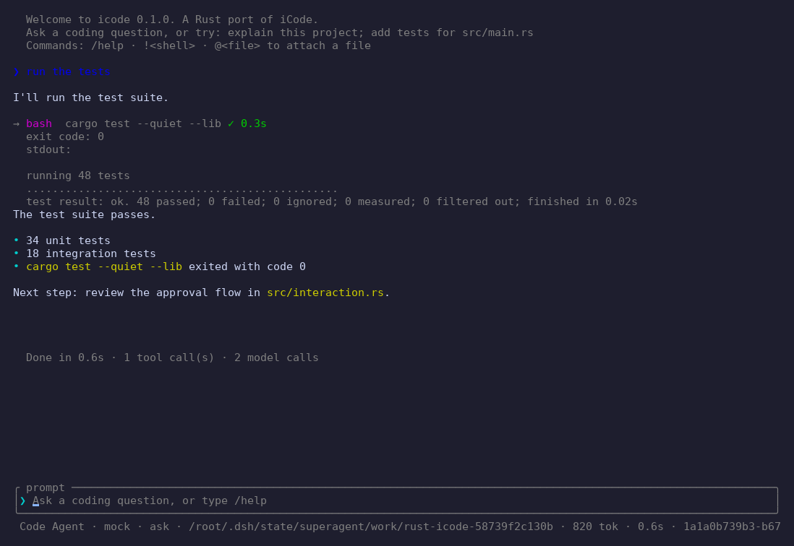
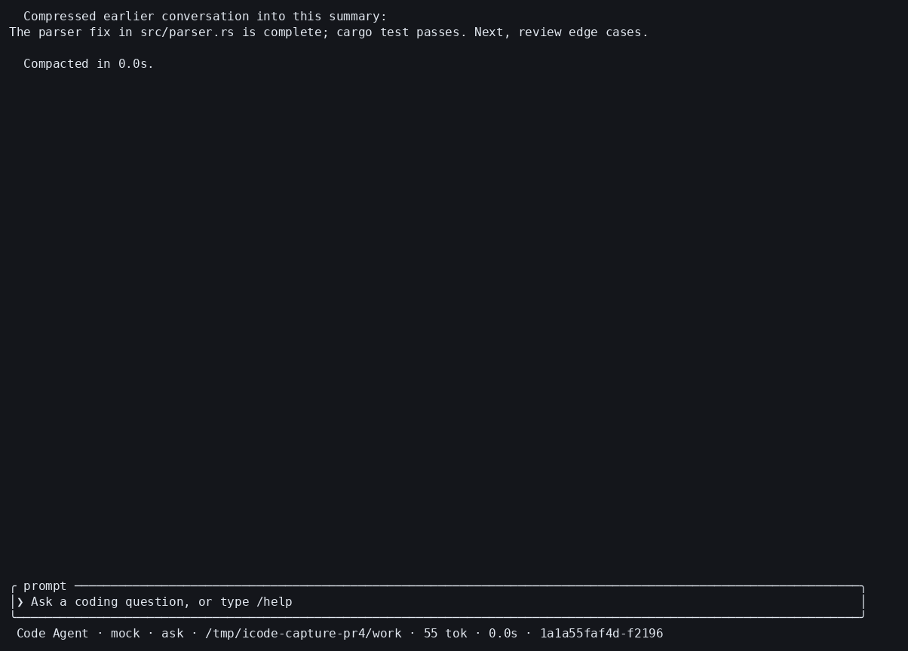

# icode（Rust 版）

用 Rust 重新实现 [openJiuwen-ai/iCode](https://github.com/openJiuwen-ai/iCode) 的核心能力：
一个运行在终端里的编码智能体（coding agent）——TUI 对话、模型接入、流式输出、
工具调用与审批、会话持久化，以及无界面的一次性任务执行。

> 本仓库当前是 **核心功能的 Rust 版本（v0.1）**，并非 iCode 的完整移植。
> 已移植与尚未移植的能力见 [docs/porting.md](docs/porting.md)。

## 特性

- **TUI 对话界面**：基于 ratatui，包含对话视图、输入框、状态栏（模型 / 审批模式 /
  工作目录 / token / 会话），支持流式 Markdown 渲染、工具调用卡片与审批弹窗。
- **模型接入**：兼容 OpenAI Chat Completions 或核心无状态 Responses API 的服务，
  支持流式 SSE、推理摘要、token 用量统计、429/5xx 自动重试和本地函数工具；Responses
  模式支持流式/非流式文本，但不支持已存储响应续传、服务端托管工具或图片。
- **智能体循环**：系统提示词 + 多轮工具调用；只读检索批次并行执行并按调用顺序回填，
  写操作与交互工具保持顺序执行；内置 Code 与只读 Q&A 两种智能体。
- **工具集**：`read_file`、`write_file`、`edit_file`、`list_dir`、`grep`、`glob`、
  `bash`、`todo_write`、`ask_user`。
- **审批策略**：`ask`（默认，逐次确认写操作与 Shell）、`auto`、`deny`。
- **会话与记忆**：JSONL 追加写入，支持 `--continue`、`/sessions`、`/resume <id>`；
  `/compact` 生成并持久化续写摘要；主 agent 自动将当前工作目录的 `AGENTS.md` 作为
  项目参考上下文加载，文件缺失时静默跳过。
- **无界面运行**：`icode run "..."`，支持 `--json` 供脚本消费。
- **输入便捷**：`/` 命令、`!` 直接执行 Shell、`@file` 附加文件内容。

## 界面

真实终端截图（118×40，DeepSeek 兼容的 mock 模型流式输出）：









## 构建

需要 Rust 1.88 或更新版本。

```bash
cargo build --release
./target/release/icode --help
```

## 配置

首次运行会自动创建 `settings.json`（Linux：`~/.config/icode/settings.json`，
macOS：`~/Library/Application Support/icode/settings.json`），也可以用
`ICODE_HOME` 指定配置与会话目录：

```bash
export ICODE_HOME="$HOME/.icode"
```

默认配置（DeepSeek）：

```json
{
  "models": [
    {
      "name": "deepseek",
      "provider": "deepseek",
      "api_style": "chat",
      "model": "deepseek-chat",
      "base_url": "https://api.deepseek.com",
      "api_key": "{{DEEPSEEK_API_KEY}}",
      "context_window": 128000,
      "max_tokens": 8192,
      "temperature": 0.1,
      "stream": true
    }
  ],
  "current_model": "deepseek",
  "approval_mode": "ask",
  "agent": "code",
  "max_tool_rounds": 40
}
```

模型配置可选填 `context_window`，表示该模型的总上下文窗口（token）。与 `max_tokens` 同时
设置后，每次请求都会以 UTF-8 字节数保守估算系统提示、对话历史和工具定义占用的 token，
并将 `max_tokens`（Responses API 中为 `max_output_tokens`）下调到估算的剩余上下文以内；
该限制不会调高配置的 `max_tokens`，Chat 与 Responses 对同一语义上下文使用相同估算。
此预算与输出上限调整不会自动压缩或裁剪对话，自动触发压缩仍未实现。

API 密钥有三种写法：

| 写法 | 含义 |
| --- | --- |
| `"sk-..."` | 直接写在配置里 |
| `"{{DEEPSEEK_API_KEY}}"` | 读取环境变量 |
| `"{{!token-provider get}}"` | 运行命令，取 stdout（30 秒超时） |

配置好后运行：

```bash
export DEEPSEEK_API_KEY=sk-...
icode                      # 打开 TUI
icode run "解释这个项目的结构" --agent qa
icode run "修复测试并运行 cargo test" --json
icode models               # 查看已配置的模型
```

## 使用

### TUI

| 按键 | 作用 |
| --- | --- |
| `Enter` | 发送消息 / 回答提问 |
| `Esc` | 取消正在运行的一轮 / 关闭弹窗 |
| `Ctrl-C` | 运行中取消，空闲时退出 |
| `Up` / `Down` | 历史输入 |
| `PgUp` / `PgDn` | 滚动对话 |
| `Tab` | 补全 `/` 命令 |

常用命令：`/help`、`/new`、`/models`、`/model <name>`、`/approval ask|auto|deny`、
`/sessions`、`/resume <id>`、`/compact`、`/cwd <path>`、`!<shell 命令>`、`@<文件>`。

主 agent 创建时会读取当前工作目录根部的普通文件 `AGENTS.md`，并按原文件整体加入系统上下文；
不搜索父目录，不加载 `ICODE.md`，也不跟随符号链接。内容会随模型请求发送给服务商，
请勿在其中放置密钥或其他敏感信息。
`AGENTS.md` 也能影响模型发起的工具调用；在不可信仓库中应先检查该文件，或以
`--approval deny` 运行无界面任务。超过约 35,000 token 预算的文件会整体跳过并显示提示。

`/compact` 会把当前完整对话作为数据交给当前模型生成续写摘要；摘要写入追加式会话文件后，
模型上下文才替换为该摘要。原始记录仍保留在 JSONL 文件中，压缩失败或被取消时不会改变当前上下文。
当前版本只支持手动触发，尚不根据上下文窗口自动压缩。

### 无界面运行

```bash
icode run "总结 src/ 下各模块的职责" --cwd . --json
```

- 最终回复写入 stdout（流式），进度写入 stderr。
- `--json` 输出单个 JSON 对象：`ok`、`text`、`usage`、`session_id`、`tool_calls`、
  `rounds`、`duration_ms`。
- 与 iCode 的 `icode run` 一致，默认不弹审批；需要时传 `--approval deny` 禁止一切写操作。
- `--session <id>` 在已有会话上继续。

## 架构

```
src/
├── cli.rs        # clap 命令行入口
├── compaction.rs # 模型辅助的上下文摘要
├── config.rs     # 模型配置、设置、API Key 解析
├── model/        # OpenAI Chat Completions 客户端 + SSE 解析
├── agent/        # 工具调用循环、事件流、系统提示词
├── tools/        # 文件、搜索、Shell、待办、提问工具
├── interaction.rs# 审批与提问接口
├── session.rs    # JSONL 会话存储
├── markdown.rs   # 终端 Markdown 渲染
├── tui/          # ratatui 界面（状态、输入、渲染）
└── run.rs        # icode run 无界面模式
```

## 测试

```bash
cargo test
cargo clippy --all-targets -- -D warnings
cargo fmt --check
```

集成测试自带一个本地 SSE mock 模型服务，覆盖流式输出、工具调用、审批、拒绝、
重试、轮次上限，以及真实 CLI 的端到端 `icode run --json`。

## 许可证

Apache-2.0，与 iCode 相同。
